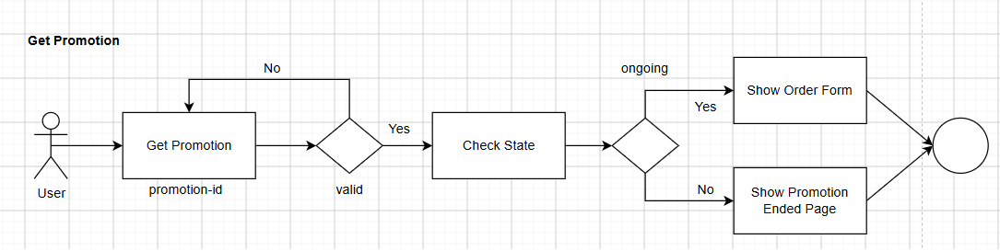
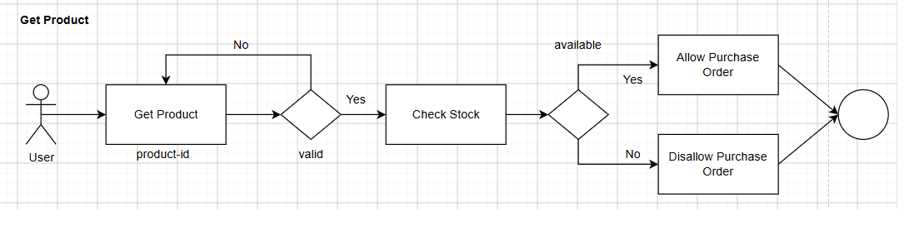
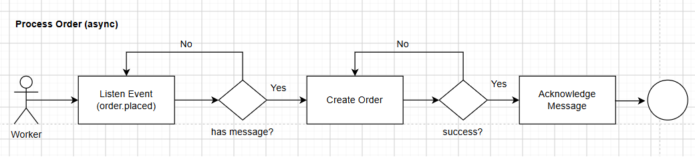
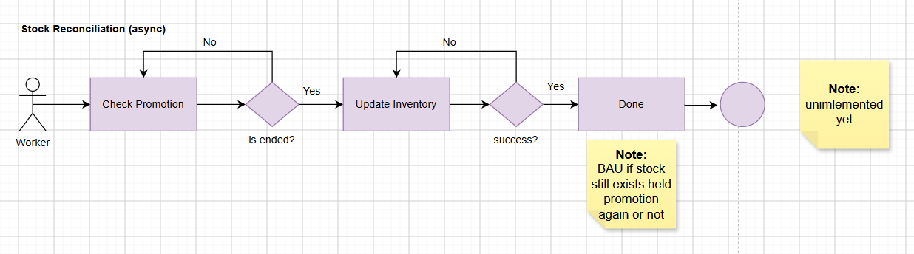
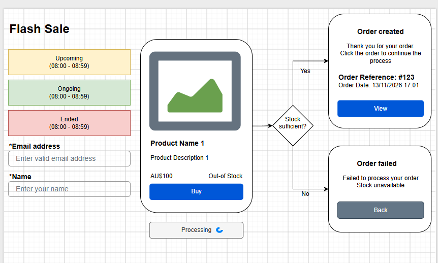

# Flash Sale

Flash sales ordering platform submission.

## Summary

Development is done by implementing and testing the system properly step-by-step with conditions such as:
1. Limited time of development
2. Unknown amount of users or traffics that we're going to handle (i assume > 1k+, and improved gradually)

Based on [Performance Testing](./TESTING.md), system is capable to handle high amount of traffics with strict unique and no over-sell ordering rules:
1. Read API = `~6775.90 RPS` with p95 `~2.01ms`
2. Write API = `~784.96 RPS` with p95 `554.49ms`

Further testing necessary:
1. API integration test (unimplemented)
2. Frontend integration test (unimplemented)
3. Chaos monkey (randomly shutting down) the infrastructure (untested)

Futher implementation necessary:
1. Check idempotency on place order API (unimplemented)
2. Check different libraries handling on outage (unchecked)
3. Fetching product stock from inventory cache instead of product cache on get product API (unimplemented)
4. Interactive timer on frontend app (unimplemented)
5. Run the redis cache and messaging on sentinel mode (unimplemented)
6. Stock reconciliation (unimplemented)

## Requirements

### Functional Requirements

1. List on-sales products

- There's only 1 product (simplification purposes)

2. User identification mechanism

- Enter user identification, e.g: username or email (simplification purposes)

3. Create order

- Allow order creation within certain `start_time` and `end_time` period
- There's only 1 product (simplification purposes)
- 1 User is only allowed to purchase 1 quantity of on-sales product (simplification purposes)

4. View order

- View order information

### Non-Functional Requirements

1. Scalability

- During peak session, there'll be a lot of users using the platform (e.g: >1k concurrent users)
- Prepare for more load, potential bottlenecks and how to mitigate the problems

2. Fault Tolerance

- System should be able to handle service crashes, network and other issues during heavy load

3. Concurrency

- Prevent over-selling and race conditions from happening when purchasing products

### Out-of Scoped Requirements

1. Authentication and user management

- No need to implement full authentication (simplification purposes)

2. Product management

- Each product has different available stock, but no need to implement the product management

3. Promotion management

- For this purposes we'd assume there will be only 1 flash sale promotion period, we won't implement the promotion management
- Promotion data will be mocked instead of using real database tables

4. Multiple currency support and currency management

- We'll assume all the currency represented in Australian Dollar (simplification purposes)
- Currency data will be mocked instead of using real database table

## System Design

### Code Architecture

1. Monorepo (commerce, frontend)
2. Clean Architecture (port-adapter)

### System Architecture


### Entity Relationship Diagram


### Flow Diagram

1. Get Promotion



2. Get Product



3. Place Order


4. Process Order



5. Get Order


6. Stock Reconciliation (unimplemented)



## User Interfaces

### 1. Mock Up



### 2. Order Placed


### 3. Order Created


Complete user interfaces: [User Interface](./UI.md)

## Design Decision
### Architecture Decisions

| Item | Description |
| :--- | :---------- |
| Monorepo | A simple setup suited to a small project built by one person. |
| Clean Architecture | • Easy to manage codes <br> • Easy to test through dependency injection <br> • Clear separation of concerns (data layer, business logic layer, etc.) |
| L7 Load Balancer (nginx) | • Acts as both web server and load balancer, distributing incoming traffic to the frontend and backend apps <br> • Uses the least-connections algorithm, so traffic goes to the instance with the lowest load <br> • Frontend and backend have separate load balancers, so each can run on different servers and be optimized for its own specification |
| Fast Centralized Inventory (Redis) | • Reduces write API load: p95 dropped from `4.81s` to `2.2s`, and throughput rose from `250 rps` to `383.31 rps` <br> • Redis is required because multiple instances of the service are deployed and need a shared inventory |
| Order Queuing (Redis Streams) | • Further reduces write API load: p95 dropped from `2.2s` to `427.43ms`, and throughput rose from `383.31 rps` to `697.92 rps` <br> • No distributed transaction or outbox is used between the inventory deduction and queue publishing. If publishing fails, stock will be inconsistent until it is corrected automatically by Stock Reconciliation (see the Stock Reconciliation flow) or manually as part of BAU <br> • Redis Streams is sufficient for testing purposes and provides durable messages that survive outages. A real production system should use proper messaging infrastructure such as RabbitMQ or Google Pub/Sub |
| L4 Load Balancer (HAProxy) | • Proxies database connections, making them easier to manage <br> • Distributes incoming traffic using the least-connections algorithm, so traffic goes to the instance with the lowest load <br> • HAProxy supports both L4 and L7; for the database it operates at L4 (TCP) |
| Database (MySQL) <br> Single Primary, Multiple Replicas | • Queuing already reduces write load, so multiple primaries are unnecessary <br> • Avoids replication lag from multi-primary writes <br> • Multiple replicas provide fault tolerance if the cache goes down |
| Cache Store (Redis) | • Reduces read API load: p95 dropped from `2.2s` to `2.01ms` and rps increased from `1470.99` to `6366.51` <br> • Redis is used because multiple instances of the service run concurrently <br> • Intended to run in Sentinel mode for fault tolerance if an instance goes down (not yet implemented) |

### Technology Decisions

| Item | Description |
| :--- | :---------- |
| REST API | I initially planned to add an API gateway connecting to gRPC services as well, but there wasn't enough time to scaffold it, and it offered no additional benefit for this challenge. |
| OpenAPI | Standardizes the API specification and generates both server and client code. It can also generate documentation, though that is out of scope here. |
| NestJS | Easy boilerplate, TypeScript support, a large library ecosystem, and good performance since it is built on top of Express. |
| React | Required by the challenge, and an easy frontend library to work with. |
| K6 | A stable, easy-to-use tool for stress testing. |
| Docker | Containerizes the whole system, making instances easy to run and manage. |
| MySQL | Easy to install and set up replication, and sufficient for demo purposes. |
| Redis | An in-memory, centralized datasource. |

## Tutorials

Make sure to configure `.env` on each projects first before running the app.

Please refer to [TESTING.md](./TESTING.md) for real stress test result of the service.

### Commands

| Project      | Command               | Description                                                |
| :----------- | :-------------------- | :--------------------------------------------------------- |
| /            | make install          | Fresh install app and infrastructure only |
| /            | make test             | Automation test each projects                              |
| /            | make test-performance | Performance testing api service, make sure the app running |
| /            | make start            | Running all the app at once locally                        |
| /            | make infra-start      | Running all the app at once inside infra                   |
| /commerce    | make install          | Install necessary dependency on service                    |
| /commerce    | make start            | Run service locally                                        |
| /commerce    | make test-performance | Performance testing api service, make sure the app running |
| /commerce    | make test-coverage    | Automation test with coverage summary                      |
| /commerce    | make infra-install    | Fresh install, make sure to setup .env on each project     |
| /commerce    | make infra-start      | Start service inside infra                                 |
| /commerce    | make infra-stop       | Stop service inside infra                                  |
| /commerce    | make infra-restart    | Restart service inside infra                               |
| /commerce    | npm run start         | Start service locally                                      |
| /commerceapi | make install          | Install generator dependency                               |
| /commerceapi | make generate-openapi | Code generator on each projects                            |
| /frontend    | make install          | Install necessary dependency on app                        |
| /frontend    | make start            | Run app locally                                            |
| /frontend    | make test-coverage    | Automation test with coverage summary                      |
| /frontend    | make infra-install    | Fresh install, make sure to setup .env on each project     |
| /frontend    | make infra-start      | Start app inside infra                                     |
| /frontend    | make infra-stop       | Stop app inside infra                                      |
| /frontend    | make infra-restart    | Restart app inside infra                                   |

## Issues

1. EventModule creation

Couldn't override the config causing docker deployment not working properly due to different host being used inside the container.

```ts
import { Module } from '@nestjs/common';
import { ConfigModule, ConfigService } from '@nestjs/config';
import { SERVICE_EVENT_TOKEN } from './event.js';
import { RedisStreamClient } from '@nestjs-redis/streams-transporter';

@Module({
  imports: [ConfigModule],
  providers: [
    {
      provide: SERVICE_EVENT_TOKEN,
      inject: [ConfigService],
      useFactory: (configService: ConfigService) => {
        return new RedisStreamClient({
          // @todo: resolve issue options not working
          url: `redis://${configService.get<string>('EVENT_REDIS_HOST')}:${configService.get<number>('EVENT_REDIS_PORT')}`,
          maxStreamLength: 1_000_000,
        });
      },
    },
  ],
  exports: [SERVICE_EVENT_TOKEN],
})
export class EventModule { }
```

To overcome this for now i use default host and port on the infrastructure so we can still `running the app locally` connecting to the infra inside docker.
If this issue still not resolved, please run the app locally through the provided commands above.

And manually removing the trim for stress-testing purposes 😅

```ts
// streams-transporter.client.js
  async dispatchEvent(packet) {
      if (!this.client) {
          throw new Error('Client not connected. Call connect() first.');
      }
      const pattern = this.normalizePattern(packet.pattern);
      const streamName = this.getRequestPattern(pattern);
      const serializedPacket = this.serializer.serialize(packet);
      const data = {
          e: '1',
          data: JSON.stringify(serializedPacket.data),
      };
      await this.client.xAdd(streamName, '*', data, 
        // @note: removed this option manually inside node_modules for publishing lot of messages to redis-stream
        // {
        //   TRIM: {
        //       strategy: 'MAXLEN',
        //       strategyModifier: '~',
        //       threshold: this.options.maxStreamLength,
        //   }
        // }
      );
      return undefined;
  }
```

_Cheers!_
