# Flash Sale

Flash sales ordering platform submission.

## Requirements

### Functional Requirements
1. List on-sales products
- There's only 1 product (simplification purposes)

2. User identification mechanism
- Enter user identification, e.g: username or email (simplification purposes)

3. Create order
- Allow order creation within certain `start_time` and `end_time` period
- There's only 1 product (simplification purposes)
- 1 User is only allowed to purchase 1 quantity of on-sales product (simplification purposes)

4. View order
- View order information

### Non-Functional Requirements
1. Scalability
- During peak session, there'll be a lot of users using the platform (e.g: >1k concurrent users)
- Prepare for more load, potential bottlenecks and how to mitigate the problems

2. Fault Tolerance
- System should be able to handle service crashes, network and other issues during heavy load

3. Concurrency
- Prevent over-selling and race conditions from happening when purchasing products

### Out-of Scoped Requirements
1. Authentication and user management
- No need to implement full authentication (simplification purposes)

2. Product management
- Each product has different available stock, but no need to implement the product management

3. Promotion management
- For this purposes we'd assume there will be only 1 flash sale promotion period, we won't implement the promotion management
- Promotion data will be mocked instead of using real database tables

4. Multiple currency support and currency management
- We'll assume all the currency represented in Australian Dollar (simplification purposes)
- Currency data will be mocked instead of using real database table

## System Design

### Code Architecture

1. Monorepo (commerce, frontend)
2. Clean Architecture (port-adapter)

### System Architecture

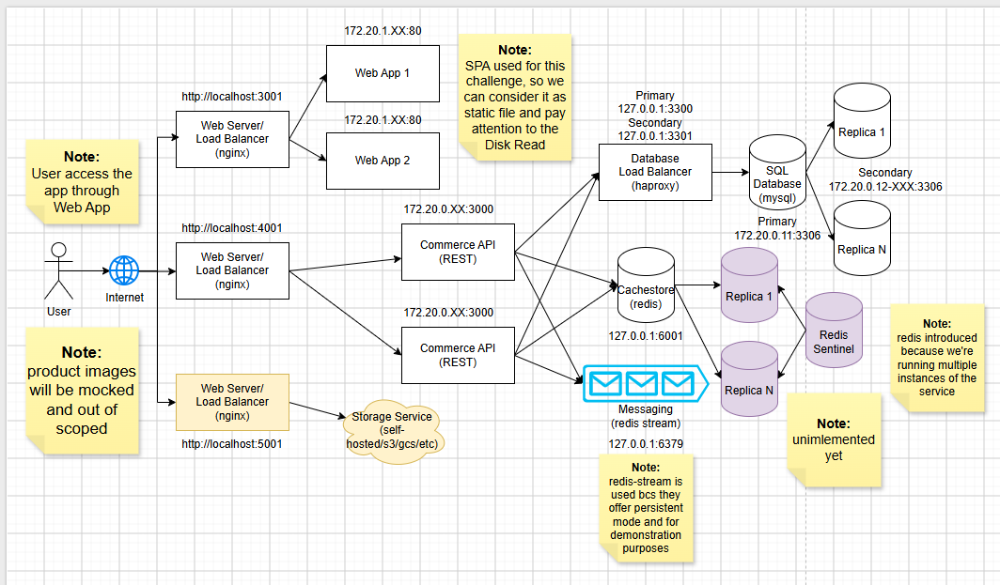

### Entity Relationship Diagram

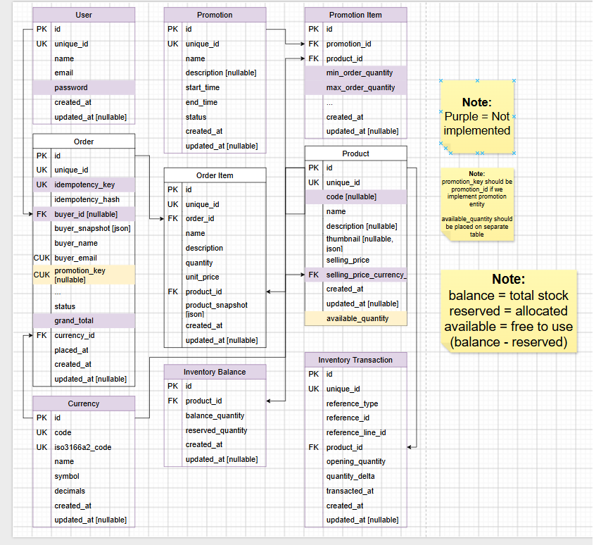

### Flow Diagram

1. Get Promotion

2. Get Product

3. Place Order

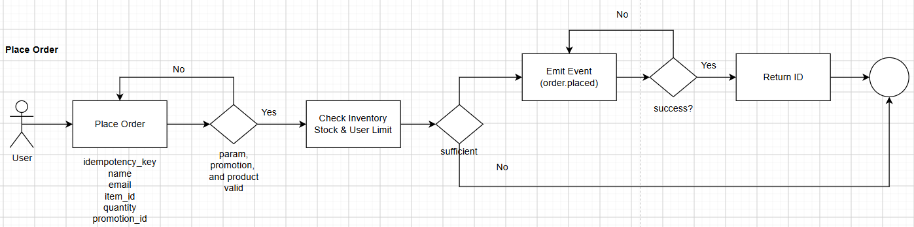

4. Process Order

5. Get Order

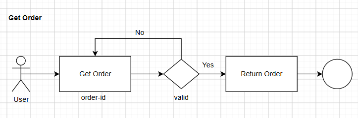

6. Stock Reconciliation

## User Interfaces

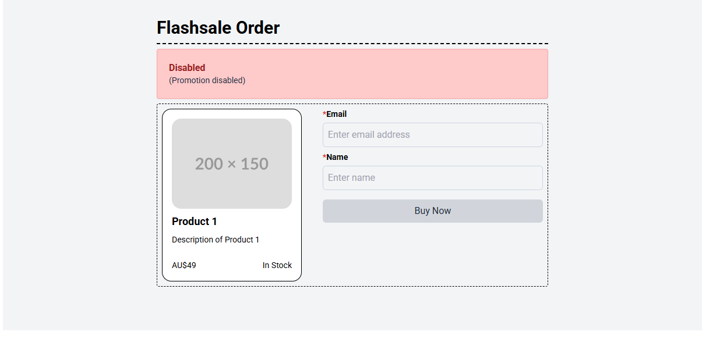

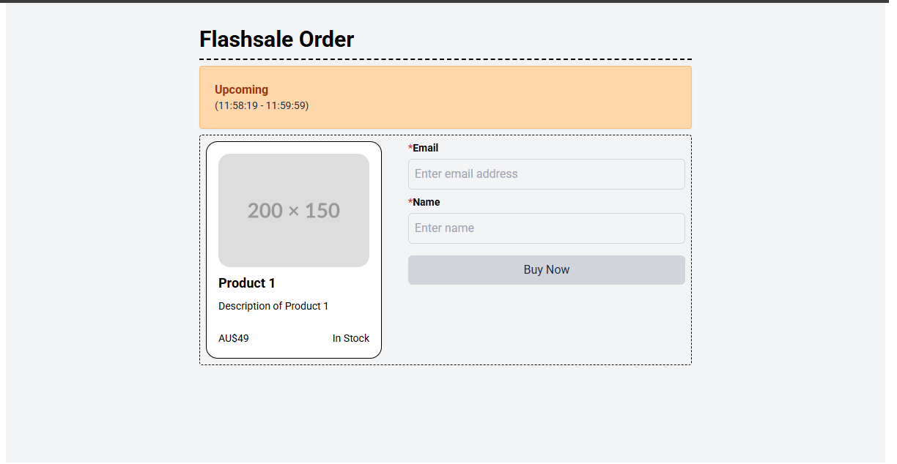

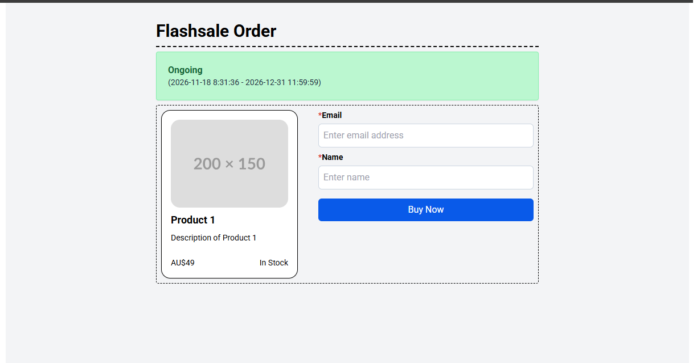

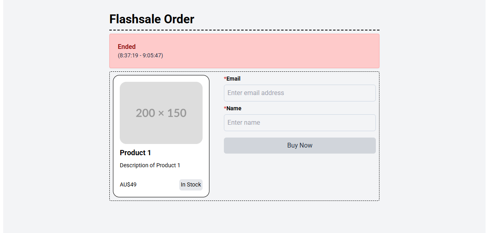

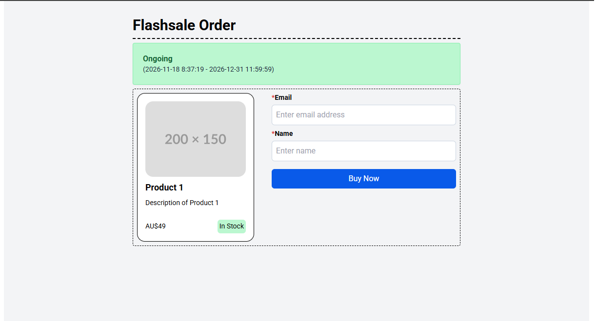

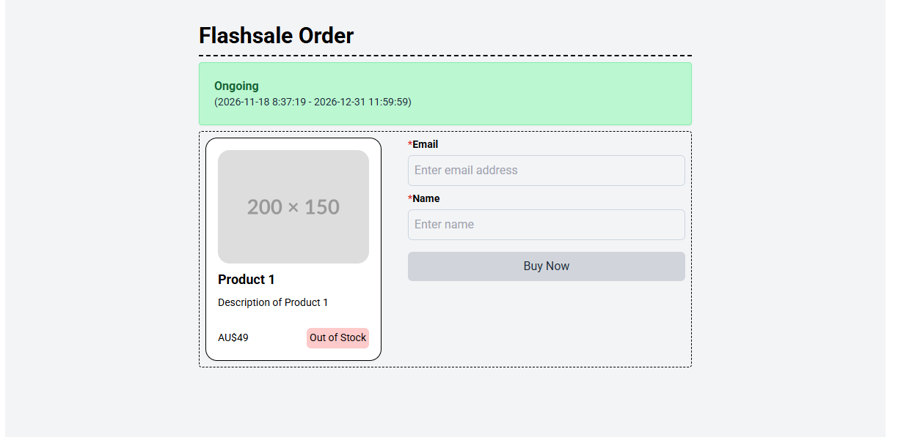

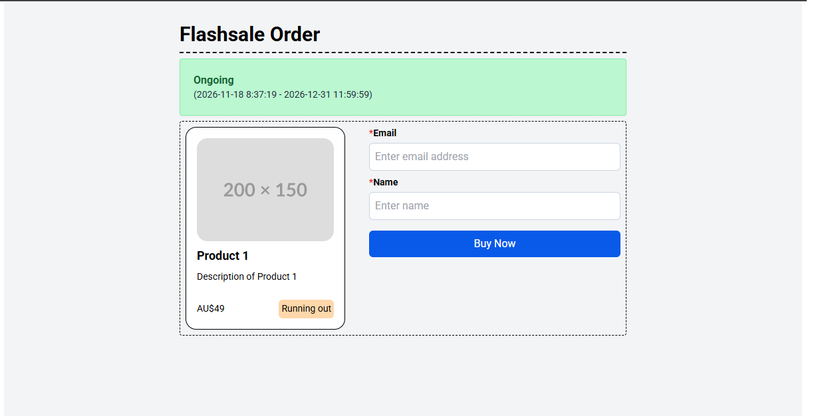

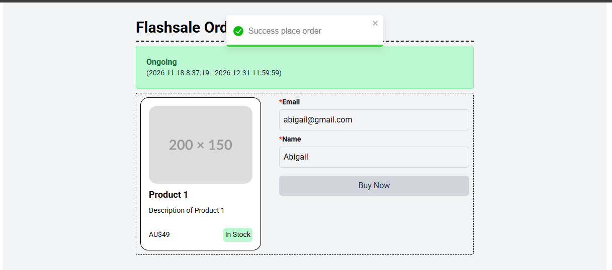

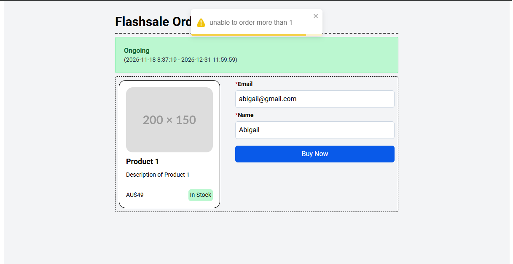

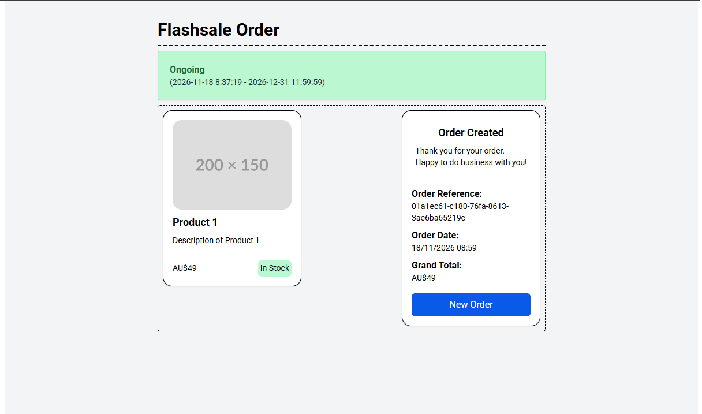

## Technologies

### Commerce (Gateway)
- NestJS = ease the service scafolding / boilerplate
- REST = client transport layer with server
- OpenAPI = generate client, server and documentation
- Grafana k6 = Performance testing tools
