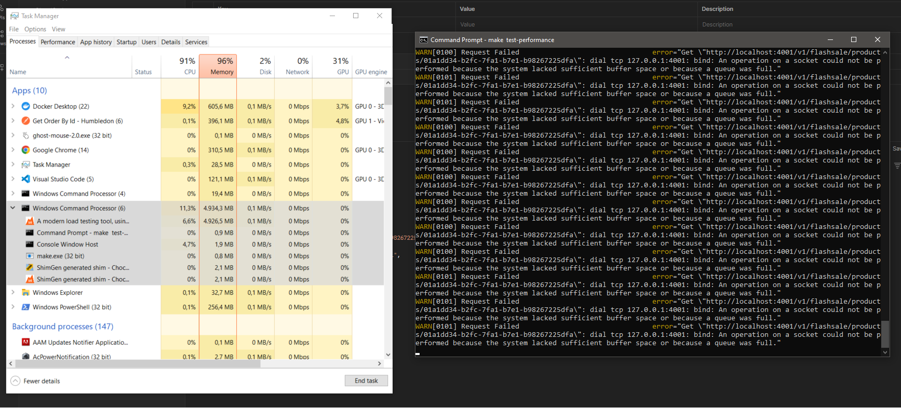

# Testing Result

### Environments
- NodeJS = v24.22.3
- NPM = 11.19.1
- CPU = i7-12700H Laptop 14 Core
- Memory = 32GB DDR5
- Database = MySQL default config with replica
- Service = NestJS rest api

## Commerce API

### Get Product API

#### Performance Testing

Testing held by running the performance test script, the result is collected through the k6 result and .csv monitoring result

1. Spike Testing 2m Spike up-to 2K VU, down to 0 in 1m

| attempt | result | req failed | avg duration | max duration| p95(<300ms) | rps | avg node cpu usage | avg node ram usage |
| :---: | :---: | :---: | :---: | :---: | :---: | :---: | :---: | :---: |
| 1 | ok | 0% | 41.34ms | 1.07s | 242.6ms | 961.36 | 11.86% | 74.88MB |
| 2 | ok | 0% | 17.27ms | 142.74ms | 88.2ms | 984.48 | 30.88% | 73.11MB |
| 3 | not ok | 0% | 62.68ms | 1.01s | 360.28ms | 942.18 | 48.55% | 93.04MB |
| 4 | ok | 0% | 33.51ms | 762.43ms | 195.36ms | 967.90 | 66.61% | 76.37MB |

Found p95 spike on attempt 3

2. Stress Testing 2m30s Load up-to 5K VU, down to 0 in 20s

| attempt | result | req failed | avg duration | max duration| p95(<300ms) | rps | avg node cpu usage | avg node ram usage |
| :---: | :---: | :---: | :---: | :---: | :---: | :---: | :---: | :---: |
| 1 | not ok | 0% | 1.17s | 4s | 2.2s | 1470.99 | 15.75% | 202.92MB |
| 2 | ok | 0% | 25.19ms | 352.85ms | 162.19ms | 3103.78 | 19.83% | 142.71MB |
| 3 | ok | 0% | 289.37µs | 44.04ms | 1.02ms | 3185.39 | 6.05% | 118.34MB |

p95 still below 300ms on attempt 2, i'd like to focus on place order implementation first for now

3. Stress Testing 2m30s Load up-to 10K VU, down to 0 in 20s

| attempt | result | req failed | avg duration | max duration| p95(<300ms) | rps | avg node cpu usage | avg node ram usage |
| :---: | :---: | :---: | :---: | :---: | :---: | :---: | :---: | :---: |
| 1 | ok | 0% | 977.47µs | 97.67ms | 2.01ms | 6366.51 | 18.92% | 126.13MB |

4. Stress Testing 2m30s Load up-to 100K VU, down to 0 in 20s

| attempt | result | req failed | avg duration | max duration| p95(<300ms) | rps | avg node cpu usage | avg node ram usage |
| :---: | :---: | :---: | :---: | :---: | :---: | :---: | :---: | :---: |
| 1 | not ok | 12.63% | 447.76ms | 26.61s | 1.92s | 4321.45 | 22.19% | 136.29MB |

5. Stress Testing 2m30s Load up-to 20K VU, down to 0 in 20s

| attempt | result | req failed | avg duration | max duration| p95(<300ms) | rps | avg node cpu usage | avg node ram usage |
| :---: | :---: | :---: | :---: | :---: | :---: | :---: | :---: | :---: |
| 1 | not ok | 58.77% | 506.93ms | 31.08s | 3.17s | 6775.90 | N/A | N/A |

#### Optimization Attempt

1. Single Database bottleneck detected

during stress test attempt 1, p95 hit 2.2s which reached the threshold 300ms

i check whether the database or the service is the bottleneck by mocking the repo result with static object, turns out when i return static object, i got p95 1.04ms.
i increased the default mysqld `max_connections` from `151` into `300` because when i checked there're more than 100 sleep or idle connection, but it doesn't help either p95 still 2.61s rps doesn't decrease either.

i added 2 database replica syncing to 1 primary database, and put 3 of them behind a proxy and separated between the primary dan secondary as follow:
- primary: localhost:3300 -> haproxy -> 172.20.0.11:3311
- secondary: localhost:3301 -> haproxy -> 172.20.0.12:3312 (weight: 5), 172.20.0.13:3313 (weight: 5), 172.20.0.11:3311 (weight: 1)

the result is attempt 2, p95 reduced to `162.19ms` and rps increased to `3103.78`

it's seems the default database config did not allow us to run with performance mode, there is room for tweaking the database, but for now let's assume it's the max resource we can get by using the default config.

2. Multiple Database still slow

after i added the database replica on optimization 1, this time i introduce caching layer to reduce the p95 and increase the rps.
i use in-memory caching on stress testing attempt 3 and able to reduce p95 to `289.37µs` but rps remain roughly the same `3185.39`, maybe because i'm using the same test scenario.
the reason i use in-memory caching because i wanted to keep it simple first.
now since i'm caching the response, i need to be able to invalidate the cache on certain resource (e.g: product.inventory.estimate_available_quantity).

i doubled the amount of VU on test 3 with 10K VU to test whether i can get more throughput or not, the result i doubled the rps but the avg, max, and rps were also doubled (still ok).

i runn another stress test 4 with 100K VU, the api is still running but cannot response successfully:
- `ECONREFUSED`
- `dial tcp 127.0.0.1:4001: connectex: No connection could be made because the target machine actively refused it.`
- `ENOBUFS`
- `dial tcp 127.0.0.1:4001: bind: An operation on a socket could not be performed because the system lacked sufficient buffer space or because a queue was full.` 

3. Load Balancer with nginx

after i dockerize the service, i sometimes still receive those error with 20K VU, but p95 and rps still not achieve and my laptop hanged with 100K VU (10GB memory usage).



*image is running 20K VUs

4. Centralized caching

since i'm running more than 1 instance of the backend service, i need to centralize the caching, that's why i'm using redis.

### Place Order API

#### Performance Testing

Testing held by running the performance test script, the result is collected through the k6 result and .csv monitoring result

1. Smoke Testing 30s up-to 5 VU

| attempt | result | req failed | avg duration | max duration| p95(<300ms) | rps | avg node cpu usage | avg node ram usage |
| :---: | :---: | :---: | :---: | :---: | :---: | :---: | :---: | :---: |
| 1 | ok | 0% | 13.24ms | 33.36ms | 242.6ms | 3.02 | 51.97% | 95.47MB |

100 qty, There's no over-sell

2. Spike Testing 2m Spike up-to 2K VU, down to 0 in 1m

| attempt | result | req failed | avg duration | max duration| p95(<300ms) | rps | avg node cpu usage | avg node ram usage |
| :---: | :---: | :---: | :---: | :---: | :---: | :---: | :---: | :---: |
| 1 | not ok | 8% | 8.57s | 28.19s | 4.81s | 250.80 | 60.09% | 168.07MB |
| 2 | not ok | 7% | 1.61s | 28.38s | 2.2s | 383.31 | 86.74% | 188.02MB |
| 3 | not ok | 3% | 433.26ms | 30.49s | 427.43ms | 697.92 | N/A | N/A |

5000 qty, There's no over-sell, found p95 spike on attempt 1

#### Optimization Attempt

1. Database locking bottleneck

during spike test attempt 1, p95 reached 4.81s, and system is only able to hit 250rps.
i found out bottleneck happened due to pessimistic locking applied on place order repo

```ts
  const product = await manager.findOne(Product, {
    where: {
      unique_id: p.item.product_id,
      available_quantity: MoreThanOrEqual(p.item.quantity),
    },
    lock: {
      mode: 'pessimistic_write'
    }
  });
  if (!product) {
    throw new Status(StatusCode.VALIDATION_INVALID_STATE, 'unsufficient product stock')
  }

  await manager.decrement(
    Product, { id: product.id },
    'available_quantity', p.item.quantity,
  );
  
```

i removed the lock and put an atomic update instead

```ts
  const decRes = await manager.decrement(
    Product,
    {
      unique_id: p.item.product_id,
      available_quantity: MoreThanOrEqual(p.item.quantity),
    },
    'available_quantity',
    p.item.quantity,
  );
  if (decRes.affected === 0) {
    throw new Status(
      StatusCode.VALIDATION_INVALID_STATE,
      'insufficient product stock',
    );
  }
```

p95 reduced to `2.2s` and rps increased to `383.31`

2. Database write exhausted

based on prev attempt, we still unable to get higher throughput and lower p95.

this happened because write operation is expensive and we don't setup our database with primary-primary setup so we can't write into multiple database server.

i put the inventory counter into cache instead of writing into database directly, by doing this (attempt 3) i managed to reduce p95 to `427.43ms` and rps to `697.92`.

```ts
  const reserveRes = await this.inventoryService.reserveStock({
    inventory_key: `inventory:${validateRes.data.item_id}`,
    identifier_key: `order:${validateRes.data.item_id}`,
    identifier_id: validateRes.data.email,
    identifier_limit: `${MAX_ORDER_PER_IDENTIFIER}`,
  })
  if (reserveRes.code != ReserveStockCode.RESERVE_SUCCESS) {
    switch (reserveRes.code) {
      case ReserveStockCode.RESERVE_OUT_OF_STOCK:
        return {
          status: new Status(StatusCode.VALIDATION_INVALID_STATE, 'insufficient product stock'),
        }
      case ReserveStockCode.RESERVE_LIMIT_REACHED:
        return {
          status: new Status(StatusCode.VALIDATION_INVALID_STATE, `unable to order more than ${MAX_ORDER_PER_IDENTIFIER}`),
        }
      default:
        return {
          status: new Status(StatusCode.VALIDATION_INVALID_STATE, 'unable to reserve order'),
        }
    }
  }

  const orderId = genIds?.ids[0].text
  const itemId = genIds?.ids[1].text

  const createRes = await this.orderRepo.createOrder({
    idempotency_key: validateRes.data.idempotency_key,
    unique_id: orderId,
    promotion_key: p.promotion_id,
    buyer_email: validateRes.data.email,
    buyer_name: validateRes.data.name,
    status: OrderStatus.PENDING,
    grand_total: getProduct.product.selling_price,
    item: {
      unique_id: itemId,
      name: getProduct.product.name,
      description: getProduct.product.description,
      product_id: getProduct.product.unique_id,
      quantity: validateRes.data.quantity,
      unit_price: getProduct.product.selling_price,
    },
    placed_at: currentTs,
    created_at: currentTs,
  })
  if (!createRes.status.is(StatusCode.SUCCESS) || !createRes.order) {
    return {
      status: createRes.status,
    }
  }

  return {
    status: new Status(StatusCode.SUCCESS, 'success place order'),
    order: {
      exists: createRes.order.exists,
      unique_id: createRes.order.unique_id,
    }
  }
```

